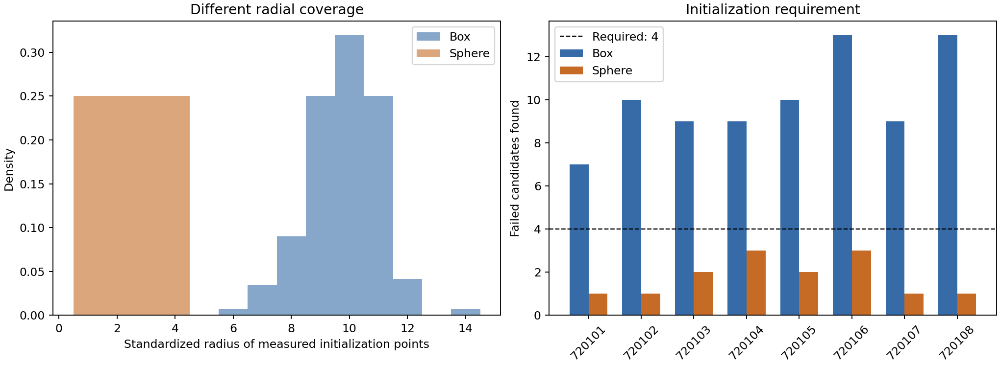
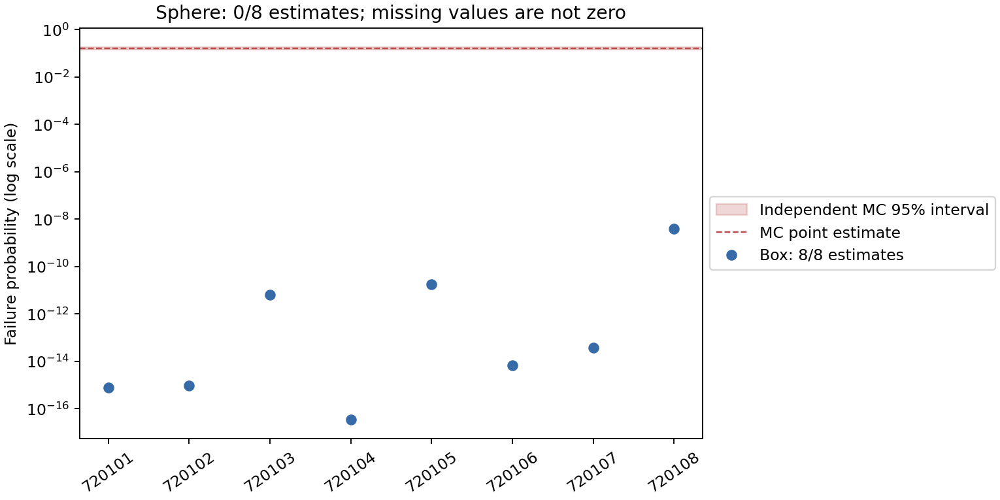

# SRAM 初始化真实对照结果

**本次没有取得球面方案改善的证据。盒式组 8 次给出严重偏低的估计；球面组 8 次都没有完成初始化。** 这是这份 SRAM 工况、初始化规则和预算下的表现，不是对所有 ACS 或球面方法的结论。

## 实际执行

执行源码为 `56320b44784c3334af16645a430de1865bb41d9f`，干净 detached worktree；配置、模型、求解器与独立参考在执行前重新核对，未变化。只启动一次，没有追加参考、换种子、调整参数或为差结果重跑。父进程耗时 **200.559 秒**，退出码 0 表示按约定处理完计划，不表示算法结果准确。

16 条任务全部有去向，8 条 budget_stopped、8 条 initialization_insufficient；没有超时、中断或未启动任务。平台分析给出目标相同 16、计划偏离 0、目标偏离 0、来源不完整 0、成本不完整 0。保留了全部失败和告警。

## 逐种子结果

| 种子 | 盒式失效率估计，0–1单位 | 盒式初始化次数 | 盒式正式次数 | 球面找到候选 | 球面结果 |
| --- | ---: | ---: | ---: | ---: | --- |
| 720101 | 7.827994156121789e-16 | 16 | 112 | 1/4 | 无估计 |
| 720102 | 9.288708560674908e-16 | 16 | 112 | 1/4 | 无估计 |
| 720103 | 6.6125662130564815e-12 | 16 | 112 | 2/4 | 无估计 |
| 720104 | 3.378195271166039e-17 | 16 | 112 | 3/4 | 无估计 |
| 720105 | 1.746975098026256e-11 | 16 | 112 | 2/4 | 无估计 |
| 720106 | 6.591308837537541e-15 | 16 | 112 | 3/4 | 无估计 |
| 720107 | 3.776029521981652e-14 | 16 | 112 | 1/4 | 无估计 |
| 720108 | 3.9087054751794416e-09 | 32 | 96 | 1/4 | 无估计 |

盒式每次总提交 132，其中复测 4。种子 720108 初始化多花 16 次，因此正式只有 96 次，其他为 112 次。它们仍属于同一总预算协议，不人为补齐正式样本数。

球面每次用完四个半径层、共 64 次初始化，只找到 1–3 个失效点，没达到预先要求的 4 个。**这不是完全没找到失效，也不是失效率为 0；是候选数量不够，不能进入正式估算。** 所有候选和缺额都保留，没有把缺失估计填零。 初始盒式的失效比例来自人为选择的初始化分布，不能直接当作目标工艺失效率。



两组比较完整初始化方案。盒式每维 ±4 的径向范围远大于半径至多 4 的球面；图中的不同不能单独归功于形状。这轮不增加第三组来重新解释结果。

## 实际成本

| 项目 | 盒式组 | 球面组 | 合计 |
| --- | ---: | ---: | ---: |
| 计划 / 有估计 | 8 / 8 | 8 / 0 | 16 / 8 |
| 无估计比例 | 0% | 100% | 50% |
| 初始化提交 | 144 | 512 | 656 |
| 复测提交 | 32 | 0 | 32 |
| 正式估计提交 | 880 | 0 | 880 |
| 提交 / 返回参数行 | 1056 / 1056 | 512 / 512 | **1568 / 1568** |
| 数值重试 | 0 | 0 | **0** |
| 包含数值重试的尝试行 | 1056 | 512 | **1568** |

按已保存请求、输入参数、测量 CSV 和求解器日志逐批核对。实际 Xyce 网表批次为 **159**，一个批次可以包含多个参数行；不能把 159 当成采样预算。版本查询不计作网表求解。1568 行包括 32 行复测，不代表 1568 个互相独立的新样本。

未用满 2112 上限是球面初始化按规则停止造成的，剩余预算没有转给其他任务。相同的是预算上限，实际成本不同，不包装成等实际成本排名。

## 相对独立参考的误差

独立参考仍为 **167/1024 = 0.1630859375**，95% Wilson 区间 **[0.14172434, 0.18696590]**，不是精确真值。以下误差相对参考点值计算，带有参考不确定度。

| 指标 | 盒式组 | 球面组 |
| --- | ---: | --- |
| 平均估计 | 4.916042361786303e-10 | 不适用 |
| 相对参考点的平均绝对误差 | 0.16308593700839577 | 不适用 |
| 相对参考点的 RMSE | 0.16308593700839574 | 不适用 |
| 正式低平均权重告警 | 8/8 | 无正式样本，不能判断 |

表内误差是概率差，0.16309 约为 16.31 个百分点。盒式所有估计都远低于参考区间，不能称为准确。球面没有完整估计，不能用 0 计算误差，也不能只比较成功子集后宣称更好。

分析器仍保留 8 条 different_source 误差标记，因为参考来自 bd09101、运行源码为 56320b4。启动前已核对相同目标、模型、求解器和目标采样器，支持这次指定参考的复用；未把来源版本强行改成相同。



## 新发现的数值精度差异

完整检查了 **110 个正式批次、880 条正式样本**。目标密度独立重算最大差为 0；候选更新、分量系数、实际方差和正式分母一致。按预先设置的 1e-10 对数密度容差，提议密度检查 **110/110 批未通过**，最大差 **5.67249425387e-06**。原失败退出码和堆栈保留，没有放宽容差。

首个已保存批次的诊断显示，标量方差路径使用 torch.float32，原记录与该路径重算完全相同；使用同一已保存方差值的 float64 向量路径时，与独立公式最大差为 2.84217094304e-14。代码路径在 `gmm_v2.py` 的标量方差构造以及 rsqrt/log 运算。这里只做已保存点上的密度计算，没有生成新样本，没有修改运行代码。

独立公式重算后的估计，与原估计最大相对差约 **5.22053416e-06**。仅就这些保存样本而言，这个微小差异无法把约 4.9e-10 变成约 0.16，不能拿它解释全部严重低估。它提供了一个后续精度核验事项，也不能据此排除其他实现或适用性问题。

因此本轮不宣称整个 ACS 符合论文、一般无偏或统计计算全部通过。初始化没完成的球面组也没有正式密度数据可供判断。本次不修复后重跑，保留冻结结果。

## 证据与复算

[sram_results](sram_results) 保存全部 16 条任务表、159 批成本表、110 批密度检查表、平台原始四表、完整分析 JSON、诊断及图。原始摘要里的差结果和告警未删。数据包独立解压后已复现全部任务、成本和密度检查表；严格密度检查仍返回预期退出码 2，没有包装成数值通过。

saved_records.zip 保存全部任务的原始摘要、候选、请求和正式样本记录，以及四份参考摘要/测量。文件逐字节保留，不改写内部历史绝对路径；RAW_SHA256.json 给出每个原文件哈希。复算脚本通过包内相对目录读取，绝不执行这些记录里的命令。

在解压目录运行以下命令，只需已有 NumPy/SciPy。预期退出码为 **2**，表示发现上述严格密度差异，表格仍全部输出；这不是启动新仿真。

```bash
python audit_saved_records.py --root run --reference-root reference --output replay
```

结论收口到本工况：盒式给出了明显低估，球面按预定规则未初始化成功，不能宣称球面改善。后续若研究半径、每层样本数或数值精度，必须另定配置和资源；本次不追加。

记录包 SHA-256：`e04472edefe527f777eb7659314684c10295a5b83719f4a1b5a52ba9a70b3e6f`。
